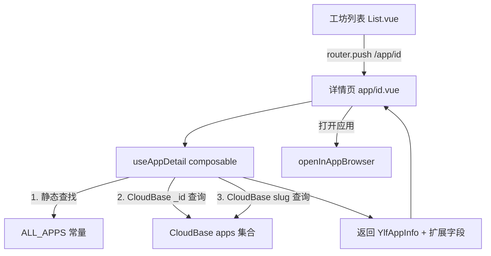

## 用户需求

工坊页面点击应用后，应直接进入 App Store 风格的应用详情页面，可查看评分、评论、开发者等完整信息。

## 产品概述

完善应用详情页 (`/app/[id]`) 的数据获取逻辑，使其同时支持静态应用和 CloudBase 数据库应用的详情展示。当前详情页仅从静态 `ALL_APPS` 数组查找应用，导致从 CloudBase 加载的应用无法正常显示（会被重定向回工坊列表）。

## 核心功能

1. **统一数据获取**：详情页支持从静态数据和 CloudBase 数据库两个数据源获取应用信息，CloudBase 应用通过 `_id` 查找，静态应用通过 `id`/`code` 查找
2. **加载状态展示**：在异步查询 CloudBase 数据期间显示加载骨架屏，避免闪烁或误跳转
3. **开发者信息展示**：从 CloudBase `AppRecord` 中读取 `ownerLogin` 作为开发者信息展示，静态应用使用默认值
4. **详情页数据完善**：将硬编码的 mock 数据替换为从数据源获取的真实字段，缺失字段优雅降级显示

## 技术栈

- 框架：Nuxt 4 (CSR) + Ionic Vue + Tailwind CSS 4
- 状态：Pinia + Vue Composables
- 数据源：CloudBase NoSQL (`apps` 集合) + 静态常量 `ALL_APPS`
- 类型：TypeScript

## 实现方案

### 核心策略

创建一个新的 composable `useAppDetail`，封装应用详情页的数据获取逻辑。该 composable 采用**静态优先 + CloudBase 补充**的两级查找策略：先在静态 `ALL_APPS` 中通过 `id` 查找，未命中则通过 CloudBase `doc(id).get()` 按 `_id` 查询公开应用，最后再尝试按 `slug` 查询。这样静态应用无需网络请求即可秒开，CloudBase 应用也能正常展示。

### 关键技术决策

1. **数据获取策略**：复用 `useDiscovery` 中已有的 `resolveApp` 模式（静态查找 + CloudBase fallback），但针对详情页扩展为支持按 `_id` 查询。`useDiscovery.resolveApp` 仅按 `slug` 查 CloudBase，而详情页的 `id` 可能是 CloudBase 的 `_id`（来自工坊列表的 `toAppInfo` 转换），因此需新增按 `_id` 的查询路径。

2. **避免误跳转**：当前 `watch(appInfo, ...)` 在 `appInfo` 为 null 时立即跳转回工坊。改为引入 `loading` 状态，仅在加载完成且数据仍为 null 时才跳转，避免异步查询期间的误跳转。

3. **AppRecord 到详情页数据的映射**：CloudBase 的 `AppRecord` 包含 `ownerLogin`、`createdAt`、`updatedAt`、`tags`、`githubRepo` 等字段，可直接映射到详情页的开发者、更新时间等展示区域，减少硬编码。

4. **安全规则兼容**：CloudBase 安全规则要求查公开数据时 where 必须包含 `isPublic: true`。按 `_id` 查询时使用 `where({ _id: id, isPublic: true })` 而非 `doc(id).get()`，确保安全规则通过。

## 实现注意事项

- **性能**：静态数据查找为 O(n) 数组遍历（30+ 项，忽略不计），CloudBase 查询仅在静态未命中时触发，且为单文档查询，延迟可控
- **向后兼容**：`getAppById` 函数保持不变，仅在详情页层面引入新的 composable，不影响其他调用方
- **错误处理**：CloudBase 查询失败时静默降级，不阻塞页面渲染；网络异常时显示"应用未找到"状态而非直接跳转
- **复用 `openInAppBrowser`**：详情页的"打开应用"按钮应使用 `openInAppBrowser` 替代 `window.open`，与主屏幕图标的行为保持一致

## 架构设计



## 目录结构

```
app/
├── composables/
│   └── useAppDetail.ts          # [NEW] 应用详情数据获取 composable，封装静态+CloudBase两级查找逻辑，返回 appData/loading/error 响应式状态。包含 resolveAppById 函数，支持按 _id 和 slug 查询 CloudBase，并将 AppRecord 映射为详情页展示所需的扩展数据结构
└── pages/
    └── app/
        └── [id].vue             # [MODIFY] 重构数据获取逻辑：引入 useAppDetail 替代 getAppById 静态查找；添加加载骨架屏；将硬编码 mock 数据替换为 composable 返回的真实数据；openApp 改用 openInAppBrowser；缺失字段条件渲染而非显示 undefined
```

## 关键代码结构

```typescript
// useAppDetail composable 核心接口
interface AppDetailData extends YlfAppInfo {
  developer: string
  version: string
  updateDate: string
  price: string
  whatsNew: string
  languages: string[]
  compatibility: string
}

function useAppDetail(appId: MaybeRef<string>): {
  appData: Ref<AppDetailData | null>
  loading: Ref<boolean>
  error: Ref<string | null>
  refresh: () => Promise<void>
}
```

## Agent Extensions

### Skill

- **vue-best-practices**
- 用途：在实现 useAppDetail composable 和修改 [id].vue 页面时遵循 Vue 3 Composition API 最佳实践
- 预期结果：代码使用 `<script setup>` + TypeScript，响应式状态管理规范

- **nuxt**
- 用途：确保 composable 符合 Nuxt 4 自动导入和 useState 模式
- 预期结果：composable 正确使用 useState 管理跨路由状态，避免 SSR 水合问题

### SubAgent

- **code-explorer**
- 用途：在实现过程中验证 CloudBase SDK 的 API 调用模式和安全规则约束
- 预期结果：确保 CloudBase 查询符合已有的安全规则配置