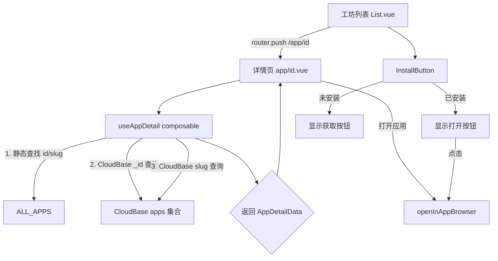

## 用户需求

工坊页面点击应用进入 App Store 风格的详情页；工坊列表中已安装应用的"获取"按钮变为"打开"按钮；统一 `code` 为 `slug` 命名。

## 产品概述

1. 完善应用详情页 (`/app/[id]`) 数据获取逻辑，同时支持静态应用和 CloudBase 数据库应用的详情展示
2. 工坊列表和本周热门中，已安装到主屏幕的应用按钮从"获取"变为"打开"，点击"打开"直接进入应用
3. 全局统一将 `YlfAppInfo.code` 字段重命名为 `slug`，消除 code/slug 双命名混乱

## 核心功能

1. **统一字段命名**：`YlfAppInfo.code` 重命名为 `slug`，同步更新所有引用点（约 15 个文件），消除 `code: record.slug` 的转换层
2. **统一数据获取**：创建 `useAppDetail` composable，详情页支持从静态数据和 CloudBase 两个数据源获取应用信息
3. **加载状态展示**：异步查询 CloudBase 数据期间显示加载骨架屏，避免闪烁或误跳转
4. **详情页数据完善**：将硬编码 mock 数据替换为真实字段，缺失字段条件渲染；openApp 使用 openInAppBrowser
5. **已安装状态按钮**：`InstallButton` 组件在已安装状态下显示"打开"按钮，点击可直接打开应用

## 技术栈

- 框架：Nuxt 4 (CSR) + Ionic Vue + Tailwind CSS 4
- 状态：Pinia + Vue Composables
- 数据源：CloudBase NoSQL (`apps` 集合) + 静态常量 `ALL_APPS`
- 类型：TypeScript

## 实现方案

### 1. code -> slug 统一重命名

将 `YlfAppInfo` 接口的 `code` 字段重命名为 `slug`。影响范围已精确定位：

**类型层**：

- `packages/types/app.ts`：`code: string` -> `slug: string`

**数据层**：

- `app/constants/apps/index.ts`：30+ 个静态应用的 `code:` -> `slug:`，`FEATURED_APP` 同理
- `app/constants/apps/builtin.ts`：`cloudOneApp` 的 `code:` -> `slug:`
- `app/constants/apps/data.ts`：17 个 `homeApps` 的 `code:` -> `slug:`

**逻辑层**（消除转换和双重匹配）：

- `app/composables/useWorkshop.ts` L38：`code: record.slug` -> `slug: record.slug`
- `app/composables/useDiscovery.ts` L26/L42：`a.code` -> `a.slug`，转换 `code:` -> `slug:`
- `app/stores/homeScreen.ts` L172：`app.id || app.code` -> `app.id || app.slug`
- `app/components/app/HomeScreenGrid.vue` L38：`a.code` -> `a.slug`
- `app/components/app/HomeScreenDock.vue` L32：`a.code` -> `a.slug`
- `app/pages/tabs/home.vue` L60：`a.code` -> `a.slug`
- `app/components/app/List.vue` L83：`app.code || app.id` -> `app.slug || app.id`
- `app/components/app/WeeklyChart.vue` L69：`app.code || app.id` -> `app.slug || app.id`
- `app/components/auth/LoginForApp.vue` L34：`appInfo.code` -> `appInfo.slug`
- `app/types/homeScreen.ts`：注释更新

### 2. useAppDetail composable

采用**静态优先 + CloudBase 补充**的两级查找策略：

1. 先在 `ALL_APPS` 中通过 `id` 或 `slug` 匹配（同步，O(n) 30+ 项忽略不计）
2. 未命中则通过 CloudBase `where({ _id: id, isPublic: true })` 按文档 ID 查询
3. 仍未命中则按 `where({ slug: id, isPublic: true })` 查询
4. 引入 `loading` 状态，仅在加载完成且数据仍为 null 时才触发跳转

复用 `useApps` 中的 CloudBase 查询模式，遵循安全规则（查公开数据 where 必须含 `isPublic: true`）。

### 3. InstallButton 已安装 -> 打开

`InstallButton` 组件目前已安装时显示"已安装"（disabled）。改为：

- 已安装：显示蓝色"打开"按钮（可点击），点击直接打开应用
- 未安装：显示"获取"按钮（现有安装逻辑不变）

给 `InstallButton` 组件新增 `app: YlfAppInfo` prop（替代原 `appId: string`），以便在"打开"时知道跳转地址。从 `app` 对象提取 `slug || id` 用于安装检查，提取 `url` 用于打开。

## 实现注意事项

- **向后兼容**：`getAppById` 函数签名不变；`getAppById` 增加 slug 匹配以兼容旧用法
- **安全规则**：CloudBase 查询按 `_id` 时使用 `where({ _id: id, isPublic: true })` 而非 `doc(id).get()`
- **性能**：静态查找无需网络请求，CloudBase 查询仅在静态未命中时触发，单文档查询延迟可控
- **错误处理**：CloudBase 查询失败时静默降级，显示"应用未找到"而非直接跳转
- **InstallButton source prop**：当前传入但未定义，本次清理移除

## 架构设计



## 目录结构

```
packages/types/
└── app.ts                              # [MODIFY] YlfAppInfo.code 重命名为 slug

app/
├── types/
│   └── homeScreen.ts                   # [MODIFY] 注释中 "slug / code" 统一为 "slug"
├── constants/apps/
│   ├── index.ts                        # [MODIFY] 30+ 个静态应用 code: -> slug:；FEATURED_APP 同理
│   ├── builtin.ts                      # [MODIFY] cloudOneApp 的 code: -> slug:
│   └── data.ts                         # [MODIFY] 17 个 homeApps 的 code: -> slug:
├── composables/
│   ├── useAppDetail.ts                 # [NEW] 应用详情数据获取 composable，封装静态+CloudBase 两级查找
│   ├── useWorkshop.ts                  # [MODIFY] toAppInfo 中 code: record.slug -> slug: record.slug
│   └── useDiscovery.ts                 # [MODIFY] resolveApp 中 a.code -> a.slug
├── stores/
│   └── homeScreen.ts                   # [MODIFY] initWithDefaults 中 app.code -> app.slug
├── components/app/
│   ├── InstallButton.vue               # [MODIFY] 接收 app 对象；已安装时显示"打开"按钮
│   ├── List.vue                        # [MODIFY] app.code -> app.slug；传 app 对象给 InstallButton
│   ├── WeeklyChart.vue                 # [MODIFY] app.code -> app.slug；传 app 对象给 InstallButton
│   ├── HomeScreenGrid.vue              # [MODIFY] a.code -> a.slug
│   └── HomeScreenDock.vue              # [MODIFY] a.code -> a.slug
├── components/auth/
│   └── LoginForApp.vue                 # [MODIFY] appInfo.code -> appInfo.slug
├── pages/
│   ├── tabs/
│   │   └── home.vue                    # [MODIFY] a.code -> a.slug
│   └── app/
│       └── [id].vue                    # [MODIFY] 接入 useAppDetail；添加骨架屏；替换 mock 数据；openApp 改用 openInAppBrowser
```

## 关键代码结构

```typescript
// useAppDetail composable 核心接口
interface AppDetailData extends YlfAppInfo {
  developer: string
  version: string
  updateDate: string
  whatsNew: string
  languages: string[]
  compatibility: string
}

function useAppDetail(appId: MaybeRef<string>): {
  appData: Ref<AppDetailData | null>
  loading: Ref<boolean>
  error: Ref<string | null>
  refresh: () => Promise<void>
}
```

## Agent Extensions

### Skill

- **vue-best-practices**
- 用途：在实现 useAppDetail composable 和修改组件时遵循 Vue 3 Composition API 最佳实践
- 预期结果：代码使用 `<script setup>` + TypeScript，响应式状态管理规范

- **nuxt**
- 用途：确保 composable 符合 Nuxt 4 自动导入规范
- 预期结果：composable 在 CSR 模式下正确工作

### SubAgent

- **code-explorer**
- 用途：验证修改范围完整性、CloudBase 查询模式
- 预期结果：确保所有 .code 引用均被更新，CloudBase 查询符合安全规则