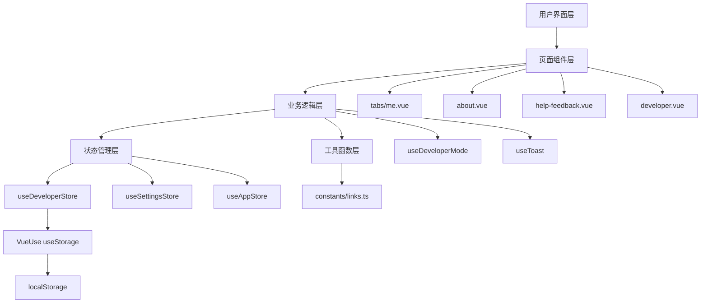

## 产品概述

为云乐坊应用的「我的」页面增加"帮助与反馈"功能模块，并实现隐藏的开发者模式入口。通过在关于页面连续点击 logo 5 次可激活开发者模式，为开发调试提供便利工具。

## 核心功能

### 帮助与反馈

- 提供业务合作邮箱入口（i@yunle.fun）
- 提供问题反馈邮箱入口（kf@yunle.fun）
- 展示客服联系方式
- 展示社交账号链接（GitHub 等）
- 邮箱点击直接跳转到系统邮件客户端

### 开发者模式

- 隐藏入口：关于页面 logo 连续点击 5 次触发
- 状态持久化：开启后在「我的」页面显示入口
- 调试信息查看：版本号、环境变量、CloudBase 环境 ID
- 环境切换：支持开发/生产 API 环境切换
- 缓存管理：清除 localStorage 和应用数据
- 日志查看：展示控制台日志
- 主动退出：提供退出开发者模式按钮

### 视觉效果

- 遵循 iOS 系统设置应用的视觉规范
- 使用圆角方块图标（29x29px）
- 列表分组清晰，使用 Konsta UI 的 inset list 样式
- 图标配色遵循现有色彩体系
- 交互反馈及时（Toast 提示、确认对话框）

## 技术栈

- **前端框架**: Nuxt 4 + Vue 3 Composition API
- **UI 组件**: Ionic Vue (iOS 模式) + Konsta UI
- **状态管理**: Pinia + VueUse
- **样式方案**: Tailwind CSS 4 + SCSS 自定义变量
- **图标库**: ionicons
- **工具库**: @vueuse/core

## 实现方案

### 方案概述

采用模块化设计，新增三个页面（帮助与反馈、开发者模式）和一个状态管理 Store。利用 Pinia + VueUse 的 `useStorage` 实现开发者模式的跨会话持久化。通过 composable 封装开发者模式的激活逻辑（点击计数器），确保代码复用性和可维护性。

### 关键技术决策

1. **状态持久化方案**：使用 VueUse 的 `useStorage`（localStorage）存储开发者模式状态，避免页面刷新后丢失。参考现有 `useSettingsStore` 和 `useAppStore` 的实现模式。

2. **点击计数器实现**：在 about.vue 中使用 `ref` 记录点击次数，通过 `setTimeout` 实现时间窗口重置（5 秒内未达到 5 次则重置计数），防止误触发。

3. **邮箱跳转**：使用 `mailto:` 协议直接调起系统邮件客户端，提供原生体验。

4. **社交链接管理**：在 `constants/links.ts` 中统一维护联系方式和社交账号配置，便于后续扩展和维护。

### 实现细节

#### 性能优化

- 开发者模式页面的日志查看功能采用虚拟滚动，避免大量 DOM 节点导致性能问题
- 使用 `computed` 缓存派生状态，减少重复计算
- 路由懒加载：新增页面自动享受 Nuxt 的代码分割优化

#### 日志记录

- 开发者模式激活/退出时使用 `console.log` 记录操作日志
- Toast 提示使用现有 `useToast` 全局单例，避免日志污染
- 错误处理统一使用 `try-catch` 并通过 `showError` 展示用户友好的错误信息

#### 影响范围控制

- 新增功能模块独立，不影响现有业务逻辑
- 仅在 `tabs/me.vue` 和 `about.vue` 中添加少量代码
- 使用条件渲染（`v-if`）控制开发者模式入口显示，不破坏原有布局
- 常量扩展向后兼容，不修改现有导出

## 架构设计

### 系统架构

项目采用分层架构，遵循 Nuxt 4 的约定式路由和自动导入机制：



### 模块划分

1. **状态管理模块**（`stores/developer.ts`）

- 管理开发者模式开启/关闭状态
- 管理 API 环境选择状态
- 提供进入/退出开发者模式的方法

2. **业务逻辑模块**（`composables/useDeveloperMode.ts`）

- 实现点击计数逻辑
- 封装开发者模式激活流程
- 提供退出确认对话框

3. **页面模块**

- `help-feedback.vue`：帮助与反馈页面
- `developer.vue`：开发者工具页面

4. **常量配置模块**（`constants/links.ts`）

- 联系方式配置
- 社交账号配置

### 数据流

用户操作 → 页面组件触发事件 → Composable 处理业务逻辑 → 更新 Pinia Store → VueUse Storage 同步到 localStorage → 页面响应式更新

## 目录结构

```
app/
├── stores/
│   └── developer.ts                    # [NEW] 开发者模式状态管理。使用 VueUse useStorage 持久化开发者模式状态（enabled、apiEnvironment）到 localStorage（键名：ylf_developer_mode）。提供 enableDevMode()、disableDevMode()、toggleApiEnv() 方法。参考 settings.ts 的实现模式。
├── pages/
│   ├── tabs/
│   │   └── me.vue                      # [MODIFY] 「我的」页面。在"通用功能" list 后添加独立的"帮助与反馈" list section（使用 chatbubbleEllipsesOutline 图标、ios-icon-blue 样式）。当 developerStore.enabled 为 true 时，在"通用功能" list 中添加"开发者模式"菜单项（使用 codeSlashOutline 图标、ios-icon-purple 样式）。
│   ├── about.vue                       # [MODIFY] 关于页面。在 logo 的 k-block 区域（第 42-54 行）添加点击事件监听，使用 useDeveloperMode composable 实现连续点击 5 次激活开发者模式。添加触觉反馈（Haptics）增强交互体验。
│   ├── help-feedback.vue               # [NEW] 帮助与反馈页面。使用 IonPage + IonHeader + IonContent 标准结构，back button 指向 /tabs/me。包含三个 list section：联系方式（业务合作、问题反馈，点击跳转 mailto:）、客服支持（在线客服按钮，使用 chatbubbleEllipses 图标）、社交账号（GitHub 等，点击打开外部链接）。所有图标使用 .ios-icon-box 样式。
│   └── developer.vue                   # [NEW] 开发者模式页面。使用 IonPage 标准结构，展示四个 list section：调试信息（版本号、CloudBase 环境 ID、构建时间，使用 informationCircleOutline 图标）、环境配置（API 环境切换，使用 globeOutline 图标，checkmarkSharp 标记当前环境）、数据管理（清除缓存按钮，使用 trashOutline 图标，带确认对话框）、退出（退出开发者模式按钮，使用 logOutOutline 图标，destructive 样式，带确认对话框）。
├── composables/
│   └── useDeveloperMode.ts             # [NEW] 开发者模式业务逻辑。提供 clickCount（点击计数）、handleLogoClick（处理点击事件，5 秒内点击 5 次激活）、confirmExitDevMode（退出确认对话框）方法。使用 useToast 显示激活/退出提示，使用 alertController 实现确认对话框，调用 developerStore 的方法更新状态。
└── constants/
    └── links.ts                        # [MODIFY] 扩展链接常量。添加 YLF_CONTACT 对象（business 和 support，包含 label 和 email 字段）。添加 YLF_SOCIAL 对象（github、twitter 等，包含 label、url 和 icon 字段）。保持现有 YLF_LINKS 导出不变。
```

## Agent 扩展

### Skill

- **vue-best-practices**
- 目的：确保 Vue 3 代码遵循 Composition API 最佳实践，使用 `<script setup>` 语法，正确使用响应式 API（ref、computed、watch）
- 预期结果：所有新增 Vue 组件和 composable 符合 Vue 3 规范，代码简洁、类型安全、性能优化

- **pinia**
- 目的：指导创建符合 Pinia 规范的 developer store，正确使用 defineStore、state、actions
- 预期结果：developer store 实现类型安全、符合项目现有 store 模式（使用 VueUse useStorage 持久化）

- **vueuse-functions**
- 目的：应用 VueUse 的 useStorage composable 实现状态持久化，参考现有 settings store 和 app store 的实现
- 预期结果：开发者模式状态正确持久化到 localStorage，页面刷新后状态保持

### MCP

无需使用 MCP 工具。

### SubAgent

无需使用 SubAgent。