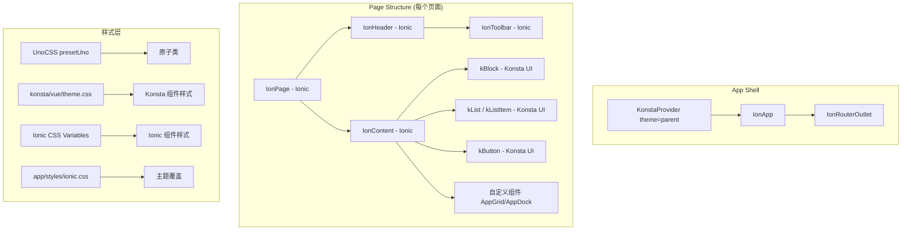

## 用户需求

对现有 Nuxt 4 + Ionic Vue + Capacitor 7 项目（"云乐坊"）进行升级和 UI 优化，使其更加符合 iOS 设计规范。

## 产品概述

云乐坊是一款以 iOS 风格为主的移动应用平台，包含 4 个主 Tab 页（云居/寻乐/工坊/我），提供应用展示、应用商店、扫码、微信登录等功能。本次需求核心是：将 Ionic 框架升级到 v8 并处理破坏性变更，集成 Konsta UI 增强 iOS 原生体验，全面优化页面 UI 使其更贴合 Apple HIG 设计规范。

## 核心特性

1. **Ionic 8 升级适配**：处理 step color token 迁移（`--ion-color-step-*` 拆分为 background/text 两组）、移除已废弃的默认颜色变量、确认 dark palette 导入方式正确、启用动态字体缩放
2. **集成 Konsta UI**：在项目中引入 Konsta UI，使用 `KonstaProvider` 包裹 `IonApp`，路由层组件（IonPage/IonHeader/IonContent）继续用 Ionic，内容区域组件（Block/List/Button 等）逐步替换为 Konsta UI 组件，实现更精致的 iOS 原生风格
3. **UI 全面优化**：优化所有页面的视觉表现，包括「我的」页面用户卡片、设置页、登录页、应用详情页等，增强 iOS 风格的圆角卡片、毛玻璃效果、分组列表、间距排版等细节，统一暗色模式适配
4. **主题色同步**：在 Ionic CSS 变量和 Konsta UI 主题配置中同步品牌色，确保两套组件体系视觉统一

## 技术栈

- **框架**：Nuxt 4 (SPA, ssr: false) + Vue 3 Composition API
- **UI 库**：Ionic Vue 8.7.7（已安装）+ Konsta UI（新增）
- **样式**：UnoCSS (presetUno + presetAttributify) + Ionic CSS Variables + Konsta UI theme.css
- **原生**：Capacitor 7.4.3 (iOS)
- **状态管理**：Pinia 3
- **暗色模式**：@nuxtjs/color-mode (classPrefix: 'ion-palette-')

## 实现方案

### 1. Ionic 8 破坏性变更处理

项目 pnpm-lock 中已安装 `@ionic/vue@8.7.7`（通过 `@nuxtjs/ionic` 模块管理），说明依赖层面已完成升级。需要处理的代码层面变更：

**Step Color Token 迁移**：

- `app/components/app/AppWeeklyChart.vue` 第 262 行：`--ion-color-step-200` 用于 `border-bottom-color`，属于边框/背景用途，需迁移为 `--ion-background-color-step-200`
- `app/styles/ionic.css` 中已经在使用 `--ion-background-color-step-*` 新语法，说明部分已迁移

**默认颜色变量清理**：

- `app/styles/ionic.css` 当前仅包含自定义覆盖（背景色、item 背景、暗色适配），没有重复定义 Ionic 8 core.css 内置的默认色板，无需清理

**Dark Palette**：

- 已通过 `@ionic/vue/css/palettes/dark.class.css` 导入，与 `@nuxtjs/color-mode` 的 `classPrefix: 'ion-palette-'` 配合，方案正确

**Dynamic Font**：

- 未使用 `--ion-default-dynamic-font`，Ionic 8 默认启用动态字体缩放，无需额外处理

**其他**：项目中无 legacy 表单语法、无 IonPicker、无 IonBackButtonDelegate、无 Toast cssClass 用法

### 2. Konsta UI 集成方案

**关键决策：UnoCSS vs Tailwind CSS**

Konsta UI 官方依赖 Tailwind CSS (`konsta/config` 包裹 tailwind.config.js)。项目使用 UnoCSS，两者核心兼容方案：

- UnoCSS 的 `presetUno()` 完全兼容 Tailwind CSS 工具类语法
- Konsta UI 的 `konsta/vue/theme.css` 是一个纯 CSS 文件，可以直接导入而不依赖 Tailwind 构建流程
- Konsta UI 组件内部使用 Tailwind 类名，UnoCSS 的 `presetUno` 能正确生成这些样式
- 品牌色同步：在 UnoCSS `theme.extend.colors` 中配置 primary 色阶，同时保持 Ionic CSS 变量中的同名定义

**集成步骤**：

1. 安装 `konsta` 包
2. 在 nuxt.config.ts 的 css 数组中加入 `konsta/vue/theme.css`
3. 在 `app.vue` 中用 `<KonstaProvider theme="parent">` 包裹 `<IonApp>`（`theme="parent"` 使 Konsta 继承 Ionic 的 `.ios` 类设定）
4. 在 UnoCSS 配置中扩展 primary 色系以匹配品牌色
5. 在页面内容区域逐步使用 Konsta UI 组件（kBlock, kList, kListItem, kButton 等）替换自定义 HTML

### 3. UI 优化策略

遵循 Apple HIG 规范，对各页面进行 iOS 风格优化：

**全局优化**：

- 统一使用 iOS 系统色（`#007AFF` primary, `#34C759` success, `#FF3B30` destructive 等）
- 使用 Konsta UI 的 List/ListItem 替换自定义列表实现，获得原生级别的 inset grouped list 效果
- 使用 Konsta UI 的 Block/BlockTitle 替换自定义内容区块
- 确保所有页面暗色模式一致性

**各页面优化重点**：

- **tabs/me.vue**：使用 Konsta UI List 组件重构用户信息卡片和功能列表
- **user/settings.vue**：使用 Konsta UI List + ListItem + Radio 重构外观设置
- **user/profile.vue**：使用 Konsta UI Card + List 重构个人资料页面
- **tabs/discovery.vue**：使用 Konsta UI Block + BlockTitle 增强发现页内容区
- **login/index.vue**：优化登录页面布局和视觉效果

## 实现注意事项

1. **Konsta 组件导入方式**：Konsta UI 不在 `@nuxtjs/ionic` 的自动导入范围内，需要手动 import 或者通过 Nuxt auto-import 配置。考虑项目已配置 `pathPrefix: false` 的组件自动导入，可在 `nuxt.config.ts` 中将 konsta/vue 加入 `imports` 配置
2. **CSS 加载顺序**：`konsta/vue/theme.css` 应在 UnoCSS reset 之后、Ionic 暗色主题之前导入，避免样式覆盖冲突
3. **KonstaProvider theme="parent"**：必须使用 `theme="parent"` 而非 `theme="ios"`，这样 Konsta 会继承 Ionic 的 `mode: 'ios'` 设定，确保主题一致
4. **不要替换路由组件**：IonPage, IonHeader, IonToolbar, IonContent, IonTabs, IonTabBar, IonRouterOutlet 必须继续使用 Ionic 版本，确保路由系统正常工作
5. **Step Color Token**：仅 `AppWeeklyChart.vue` 一处需要迁移，使用 `--ion-background-color-step-200` 替换
6. **暗色模式**：Konsta UI 的暗色模式通过 `.dark` 类或 `dark` prop 控制，需要确保与项目的 `ion-palette-dark` class 模式兼容，可能需要在 KonstaProvider 上设置 `dark` prop 动态绑定

## 架构设计



## 目录结构

```text
app/
├── app.vue                          # [MODIFY] 引入 KonstaProvider 包裹 IonApp，绑定 dark mode 状态
├── components/
│   └── app/
│       └── AppWeeklyChart.vue       # [MODIFY] 迁移 --ion-color-step-200 → --ion-background-color-step-200
├── pages/
│   ├── tabs/
│   │   ├── me.vue                   # [MODIFY] 使用 Konsta UI List/ListItem 重构用户信息和功能列表
│   │   └── discovery.vue            # [MODIFY] 使用 Konsta UI Block/BlockTitle 优化内容区域
│   ├── user/
│   │   ├── settings.vue             # [MODIFY] 使用 Konsta UI List/Radio 重构设置页
│   │   └── profile.vue              # [MODIFY] 使用 Konsta UI 组件优化个人资料页
│   └── login/
│       └── index.vue                # [MODIFY] 优化登录页面 iOS 风格
├── styles/
│   ├── ionic.css                    # [MODIFY] 清理已内置的默认色变量，补充 Ionic 8 新 token
│   └── scss/
│       └── override.scss            # [MODIFY] 添加 Konsta UI 与 Ionic 样式协调覆盖
├── nuxt.config.ts                   # [MODIFY] 添加 konsta/vue/theme.css 到 css 数组，配置 Konsta 组件自动导入
├── uno.config.ts                    # [MODIFY] 扩展 theme.colors.primary 色系
└── package.json                     # [MODIFY] 添加 konsta 依赖
```

## 设计风格

采用 Apple HIG (Human Interface Guidelines) 设计规范，打造纯正 iOS 原生体验。通过 Ionic 8 + Konsta UI 双组件体系，实现精致的分组列表、毛玻璃工具栏、圆角卡片等 iOS 标志性视觉元素。

## 全局设计规范

### 导航与布局

- 顶部采用 iOS 标准 Large Title 效果（IonHeader translucent + IonTitle）
- 底部 Tab 栏使用 Ionic IonTabBar，保持系统级导航体验
- 页面内容区域使用 Konsta UI 的 Block 和 List 组件，获得 iOS 原生级别的 inset grouped list 效果
- 内容间距遵循 iOS 标准：16px 水平边距，8-16px 块间距

### 列表与卡片

- 使用 Konsta UI 的 List（inset 模式）替代 Ionic IonList，获得更精致的圆角分组效果
- 列表项使用 Konsta UI ListItem，支持 media slot、title、after、subtitle 等标准 iOS 列表布局
- 卡片遵循 iOS 风格：12-16px 圆角、轻微阴影、白色/暗色背景

### 交互与动画

- 点击反馈：列表项点击时轻微灰色高亮，按钮按下时 scale(0.95) 缩放
- 页面切换：使用 Ionic 标准 iOS push/pop 过渡动画
- 滚动效果：工具栏透明模糊（backdrop-filter）效果

### 暗色模式

- 完整支持系统跟随、手动浅色、手动深色三种模式
- 暗色背景使用 iOS 标准色：#000000 纯黑背景、#1C1C1E 卡片/列表背景
- 分割线使用 iOS 暗色标准：rgba(84, 84, 88, 0.48)

## 页面设计

### 1. 云居页（tabs/home）

- **顶部区域**：iOS 标准工具栏 + 搜索栏，毛玻璃半透明效果
- **最近使用区块**：Konsta UI BlockTitle + 水平滚动应用图标列表
- **应用网格区块**：保持现有 AppGrid 自定义实现（已经很接近 iOS 桌面风格）
- **底部 Dock**：保持现有毛玻璃 Dock 设计

### 2. 寻乐页（tabs/discovery）

- **顶部区域**：大标题 "云乐坊" + 用户头像按钮
- **今日推荐**：保持现有渐变卡片设计，使用 Konsta UI BlockTitle
- **本周热门**：使用 Konsta UI List/ListItem 重构排行榜列表，media slot 显示应用图标，after slot 显示获取按钮

### 3. 工坊页（tabs/apps）

- **顶部区域**：搜索栏 + 分类筛选 Segment
- **应用列表**：使用 Konsta UI List/ListItem 重构，更精致的 iOS App Store 风格

### 4. 我的页（tabs/me）

- **用户信息区**：Konsta UI List inset，大头像 + 昵称的 ListItem
- **功能列表**：Konsta UI List inset 分组，个人资料/设置/关于分组显示
- **退出登录**：单独分组，destructive 红色文字

### 5. 设置页（user/settings）

- **外观设置**：Konsta UI List + ListItem + Radio，iOS 标准设置项风格
- **列表头**：使用 Konsta UI BlockTitle 替代 IonListHeader

### 6. 个人资料页（user/profile）

- **头像卡片区**：居中大头像 + 昵称 + 性别标签
- **详细信息**：Konsta UI List inset 分组，标准 iOS 信息展示
- **操作按钮**：Konsta UI List inset 分组，刷新/设置/退出

## Agent Extensions

### Skill

- **nuxt**
- 用途：查阅 Nuxt 4 文档中关于 CSS 导入、模块配置、auto-imports 配置的最佳实践
- 预期结果：确保 nuxt.config.ts 中 Konsta UI 集成方式符合 Nuxt 4 规范

- **vue-best-practices**
- 用途：确保所有页面组件重构遵循 Vue 3 Composition API + script setup 最佳实践
- 预期结果：组件代码简洁、类型安全、可维护性强

- **unocss**
- 用途：配置 UnoCSS theme 扩展和自定义 shortcuts 以支持 Konsta UI 主题色同步
- 预期结果：UnoCSS 能正确生成 Konsta UI 组件所需的工具类

- **pnpm**
- 用途：安装 konsta 依赖包
- 预期结果：正确安装 konsta 包并更新 pnpm-lock.yaml

### MCP

- **fetch**
- 用途：查阅 Konsta UI 官方文档中各 Vue 组件的 API 和 Props，确保集成正确
- 预期结果：获取 KonstaProvider、kList、kListItem、kBlock 等组件的准确用法

### SubAgent

- **code-explorer**
- 用途：在实施过程中查找项目中所有需要迁移的 step color token 和其他 Ionic 8 变更点
- 预期结果：确保不遗漏任何需要迁移的代码
