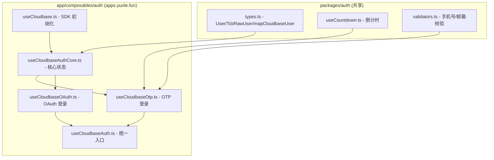

## 用户需求

在 `apps.yunle.fun` 的"我的"页面（`me.vue`）中，点击"登录「云乐坊」账户"后跳转到登录页面，支持多种登录方式，并参考 `www.yunle.fun` 已有的认证实现。

## 产品概述

重构 `apps.yunle.fun` 的登录系统，从当前仅支持微信登录 + 短信登录（旧版 CloudBase SDK），升级为基于 CloudBase Auth 新版 SDK 的完整多方式登录体系，采用 iOS 原生风格设计。同时将两个项目间可复用的认证逻辑提取到共享包 `@yunlefun/auth`。

## 核心功能

1. **手机号验证码登录**：输入手机号 → 获取验证码 → 验证登录，支持新用户自动注册
2. **邮箱验证码登录**：输入邮箱 → 获取验证码 → 验证登录（仅已绑定用户）
3. **GitHub OAuth 登录**：点击 GitHub 按钮跳转 GitHub 授权页，回调后自动完成登录
4. **微信 OAuth 登录**：点击微信按钮跳转微信授权页，回调后自动完成登录
5. **登录方式切换**：iOS 风格分段控件（Segmented Control）在手机号和邮箱之间切换，第三方登录（GitHub/微信）显示在分割线下方
6. **OAuth 回调处理页**：统一处理 GitHub/微信 OAuth 回调，展示登录状态并自动跳转
7. **共享认证逻辑**：将 `useCountdown`、CloudBase Auth 类型定义、`mapCloudbaseUser`、错误信息映射等纯工具函数提取到 `packages/auth` 共享包中，供两个项目复用

## 技术栈

- **前端框架**: Nuxt 4 (SSR 关闭, `ssr: false`)
- **UI 框架**: Ionic Vue (`@nuxtjs/ionic`, mode: `ios`) + Konsta UI (`konsta/vue`)
- **状态管理**: Pinia (`@pinia/nuxt`)
- **认证 SDK**: `@cloudbase/js-sdk` (已安装 ^2.25.7)，升级使用新版 Auth API（`signInWithOtp` / `signInWithOAuth`）
- **样式**: UnoCSS + Tailwind CSS + SCSS
- **共享包**: `@yunlefun/auth`（packages/auth，通过 alias 引用）

## 实现方案

### 核心策略

参考 `www.yunle.fun` 已验证的模块化 Composable 架构（`useAuthCore` / `useOtp` / `useOAuth`），将其适配到 `apps.yunle.fun` 的 Ionic + Konsta UI 环境中。认证底层统一使用 CloudBase Auth 新版 API（`auth.signInWithOtp` / `auth.signInWithOAuth`），替换当前旧版 `$tcbAuth.getVerification` / `signInWithSms` 方式。

### 关键技术决策

1. **升级到 CloudBase Auth 新版 API**：当前 `useSmsAuth.ts` 使用旧版 `$tcbAuth.getVerification` / `signInWithSms`，参考 www 项目的 `useOtp.ts` 使用 `auth.signInWithOtp({ phone })` 新版 API。新 API 更简洁、支持邮箱 OTP、与 OAuth 共享同一 auth 实例。

2. **Composable 模块化拆分**：沿用 www 项目的 `useAuthCore` + `useOtp` + `useOAuth` 模式，但需适配 apps 项目的差异：

- apps 使用 Ionic Toast（`useToast` 返回 `showSuccess` / `showError`），而非 Nuxt UI 的 `toast.add`
- apps 使用 Pinia Store（`useUserStore`）管理 Cookie JWT 状态，而非 `useState`
- 登录成功后跳转 `/tabs/me` 而非 `/`

3. **CloudBase SDK 初始化复用**：新建 `useCloudbase.ts` composable，参考 www 项目的实现，使用 `cloudbase.init()` 初始化并缓存在 `useNuxtApp()` 上。使用已有的 `runtimeConfig.public.tcbEnvId`。

4. **OAuth 回调**：新建 `/auth/callback` 页面处理 GitHub / 微信 OAuth 回调。CloudBase SDK 的 `detectSessionInUrl: true` 会自动解析 URL 中的 OAuth 参数，回调页只需调用 `checkAuthStatus` → `fetchUser` → 跳转。

5. **共享包提取**：将以下纯工具逻辑提取到 `packages/auth/src/shared/`：

- `useCountdown` — 验证码倒计时（无框架依赖，仅使用 Vue reactivity）
- `types.ts` — `User`、`TcbRawUser`、`mapCloudbaseUser`、`getErrorMessage` 等类型和工具函数
- `validators.ts` — 手机号/邮箱校验正则

6. **保留旧版短信登录兼容**：不删除 `useSmsAuth.ts`，仅标记 `@deprecated`，新登录页使用新版 composable。

## 实现注意事项

- **CloudBase SDK 版本兼容**：`@cloudbase/js-sdk@^2.25.7` 已支持新版 Auth API（`signInWithOtp` / `signInWithOAuth` / `getUser` / `getSession`）。无需升级版本，但需要确认初始化时传入 `auth: { detectSessionInUrl: true }` 以支持 OAuth 回调自动解析。
- **runtimeConfig 扩展**：当前 `nuxt.config.ts` 已有 `tcbEnvId`，需补充 `cloudbaseRegion` 和 `cloudbaseAccessKey`（参考 www 项目配置），用于 `cloudbase.init()`。这些值可为空字符串，在 `.env` 中配置。
- **登录成功后的状态同步**：CloudBase Auth 的 `fetchUser` 获取用户信息后，需要同步更新 `useUserStore` 的 `login(token, user)` 方法。需要从 CloudBase Session 中获取 `access_token`，并将 CloudBase User 映射为 `YlfUserInfo` 格式。
- **向后兼容**：保留现有 `useUserStore` 的 Cookie JWT 机制不变，CloudBase Auth 登录成功后将 session token 写入 store，确保其他模块（如 `useLogout`）继续正常工作。
- **Ionic 导航**：OAuth 登录会导致页面跳转到外部授权页，返回时通过 `/auth/callback` 路由处理。Ionic 的 `IonRouterOutlet` 正常支持此场景。

## 架构设计

### 认证数据流

```mermaid
graph TD
    A[me.vue 点击登录] --> B[/login 登录页]
    B --> C{选择登录方式}
    C -->|手机号| D[useCloudbaseAuth.sendPhoneOtp]
    C -->|邮箱| E[useCloudbaseAuth.sendEmailOtp]
    C -->|GitHub| F[useCloudbaseAuth.loginWithGitHub]
    C -->|微信| G[useCloudbaseAuth.loginWithWeChat]
    D --> H[输入验证码 → verifyPhoneOtp]
    E --> I[输入验证码 → verifyEmailOtp]
    F --> J[跳转 GitHub 授权]
    G --> K[跳转微信授权]
    H --> L[CloudBase Auth fetchUser]
    I --> L
    J --> M[/auth/callback]
    K --> M
    M --> N[checkAuthStatus + fetchUser]
    N --> L
    L --> O[mapCloudbaseUser → YlfUserInfo]
    O --> P[userStore.login token+user]
    P --> Q[跳转 /tabs/me]
```

### Composable 架构



## 目录结构

本次实现在现有项目中添加 CloudBase Auth 多方式登录功能，涉及共享包扩展、新 Composable 创建、登录页重构和 OAuth 回调页新建。

```
apps.yunle.fun/
├── packages/auth/src/
│   ├── index.ts                              # [MODIFY] 补充导出 shared 模块
│   ├── shared/
│   │   ├── index.ts                          # [NEW] shared 模块导出桶文件
│   │   ├── types.ts                          # [NEW] 从 www 项目提取的 CloudBase Auth 类型定义（TcbRawUser/User/AuthState/TcbOtpData 等）和 mapCloudbaseUser 映射函数、getErrorMessage 错误映射。两个项目共用，避免类型定义重复。
│   │   ├── useCountdown.ts                   # [NEW] 从 www 项目提取的通用验证码倒计时工具。使用 Vue ref/computed/onUnmounted，无其他依赖。两个项目均需此功能。
│   │   └── validators.ts                     # [NEW] 共享校验工具：手机号正则 isValidPhone(+86)、邮箱正则 isValidEmail。从 www 登录页提取，统一校验逻辑。
│   └── types/
│       └── user.ts                           # [MODIFY] 扩展 YlfUserInfo 接口，增加 id/email/phone/login 等字段以兼容 CloudBase User 映射
├── app/
│   ├── composables/
│   │   ├── auth/
│   │   │   ├── useCloudbase.ts               # [NEW] CloudBase SDK 初始化 composable。参考 www 项目实现，使用 cloudbase.init() + useNuxtApp() 缓存，读取 runtimeConfig.public.tcbEnvId。返回 { app, auth } 对象。
│   │   │   ├── useCloudbaseAuthCore.ts       # [NEW] 认证核心状态管理。参考 www 的 useAuthCore.ts，管理 user/loading/error 状态，提供 fetchUser(通过 auth.getUser)、checkAuthStatus(通过 auth.getSession)、logout(调用 auth.signOut + userStore.logout)。适配 Ionic Toast 通知和 Pinia Store 状态同步。
│   │   │   ├── useCloudbaseOtp.ts            # [NEW] OTP 验证码登录。参考 www 的 useOtp.ts，实现 sendPhoneOtp/verifyPhoneOtp/sendEmailOtp/verifyEmailOtp/signUpWithPhone/verifySignUpOtp。使用新版 auth.signInWithOtp API。登录成功后调用 fetchUser → 同步 userStore → 跳转。
│   │   │   ├── useCloudbaseOAuth.ts          # [NEW] OAuth 第三方登录。参考 www 的 useOAuth.ts，实现 loginWithGitHub/loginWithWeChat（调用 auth.signInWithOAuth，redirectTo 为 /auth/callback）。
│   │   │   ├── useCloudbaseAuth.ts           # [NEW] 认证统一入口 composable。参考 www 的 useTcbAuth.ts，组合 Core + Otp + OAuth 模块，对外暴露扁平化 API。
│   │   │   ├── index.ts                      # [MODIFY] 补充导出新的 useCloudbaseAuth composable
│   │   │   └── useSmsAuth.ts                 # [MODIFY] 添加 @deprecated 注释，标记为弃用
│   ├── pages/
│   │   ├── login/
│   │   │   └── index.vue                     # [MODIFY] 重构登录页。替换当前微信回调处理 + UserLogin 组件的简单布局，改为完整的多方式登录页面：iOS 风格 Segmented Control 切换手机号/邮箱，验证码输入，GitHub/微信第三方登录按钮。使用 Ionic + Konsta UI 组件，保持 iOS 原生感。
│   │   └── auth/
│   │       └── callback.vue                  # [NEW] OAuth 回调处理页。参考 www 的 auth/callback.vue，处理 GitHub/微信 OAuth 回调：检查认证状态 → fetchUser → 同步到 userStore → 显示结果 → 跳转 /tabs/me。使用 Ionic 组件展示加载/成功/失败状态。
│   ├── styles/
│   │   └── scss/
│   │       └── auth.scss                     # [NEW] 登录页专用样式：iOS 风格 Segmented Control、表单圆角输入框、第三方登录按钮等样式。
│   └── nuxt.config.ts                        # [MODIFY] runtimeConfig.public 中补充 cloudbaseRegion 和 cloudbaseAccessKey 配置项（空字符串默认值）
```

## 关键代码结构

```typescript
// packages/auth/src/shared/types.ts - 核心类型（从 www 项目提取）
export interface TcbRawUser {
  id: string
  email: string | null
  phone: string | null
  app_metadata: { provider: string | null, providers: string[] }
  user_metadata: { name: string | null, username: string | null, nickName: string | null, avatarUrl: string | null, picture: string | null, hasPassword: boolean | null }
  identities: Array<{ id: string, name: string, picture: string }> | null
  created_at: string
  updated_at: string
}

export interface CloudbaseUser {
  id: string
  login?: string | null
  email?: string | null
  phone?: string | null
  nickname?: string
  avatar?: string | null
  hasPassword: boolean
  providers: string[]
}

export function mapCloudbaseUser(raw: TcbRawUser): CloudbaseUser | null
export function getErrorMessage(err: unknown): string
```

```typescript
// app/composables/auth/useCloudbaseAuth.ts - 统一入口签名
export function useCloudbaseAuth(): {
  // 状态
  user: Readonly<Ref<CloudbaseUser | null>>
  loading: Readonly<Ref<boolean>>
  error: Readonly<Ref<string | null>>
  isAuthenticated: ComputedRef<boolean>
  // OTP
  sendPhoneOtp: (phone: string) => Promise<TcbOtpData>
  verifyPhoneOtp: (otpData: TcbOtpData, token: string) => Promise<void>
  sendEmailOtp: (email: string) => Promise<TcbOtpData>
  verifyEmailOtp: (otpData: TcbOtpData, token: string) => Promise<void>
  // OAuth
  loginWithGitHub: () => Promise<void>
  loginWithWeChat: () => Promise<void>
  // 通用
  fetchUser: () => Promise<CloudbaseUser | null>
  checkAuthStatus: () => Promise<void>
  logout: () => Promise<void>
}
```

## 设计风格

采用 Apple iOS Settings 原生风格设计，保持与应用整体 Ionic + Konsta UI 一致的视觉语言。登录页模拟 iOS 系统设置中的 Apple ID 登录体验，使用分组列表（Inset List）、圆角卡片、iOS 分段控件（Segmented Control）等原生组件元素。

## 页面设计

### 登录页 `/login`

#### 顶部导航栏

- iOS 标准导航栏，左侧"返回"按钮（IonBackButton，default-href="/tabs/me"），标题"登录"

#### Logo 区域

- 居中显示应用 Logo 组件
- 下方标题"登录云乐坊"，副标题"使用您的云乐坊账号继续"
- 与底部内容间距适当，营造呼吸感

#### 登录方式切换（iOS Segmented Control）

- 使用 iOS 原生分段控件样式，两个选项："手机号" / "邮箱"
- 选中状态为白色滑块 + 投影，未选中为透明文字
- 背景为系统灰色圆角条（`#E9E9EA` light / `#39393D` dark）

#### 手机号登录表单

- 使用 Konsta UI `k-list` inset 分组样式包裹表单项
- 区号选择 "+86"（固定，灰色前缀），手机号输入框
- "获取验证码"按钮：k-button large 主色调，宽度撑满
- 验证码输入后显示验证码输入行 + 重发倒计时按钮 + "登录"主按钮

#### 邮箱登录表单

- 同样使用 k-list inset 包裹
- 邮箱输入框，获取验证码按钮
- 底部提示文字"邮箱仅支持已绑定的用户登录"

#### 分割线

- "或" 文字居中，两侧细线，iOS 系统配色

#### 第三方登录按钮区域

- 两个圆角按钮纵向排列，outline 风格
- GitHub 按钮：GitHub 图标 + "GitHub 登录"
- 微信按钮：微信图标 + "微信登录"（绿色图标）

#### 底部注册链接

- "还没有云乐坊账号？立即注册"链接文字
- "登录即表示您同意服务条款和隐私政策"

### OAuth 回调页 `/auth/callback`

- 顶部导航栏，标题"登录中"
- 居中显示状态：IonSpinner 加载动画 / 成功勾 / 失败叉
- 状态文字描述
- 失败时显示"返回登录"按钮

## Agent Extensions

### Skill

- **vue-best-practices**
- Purpose: 确保所有 Vue 组件遵循 Composition API + `<script setup>` + TypeScript 最佳实践
- Expected outcome: 所有新建组件和 Composable 符合 Vue 3 最佳实践规范

- **nuxt**
- Purpose: 确保 Nuxt 4 的 auto-imports、runtimeConfig、pages 路由等配置正确
- Expected outcome: Composable 自动导入、runtimeConfig 类型安全、文件路由正常工作

- **pinia**
- Purpose: 确保 userStore 的状态管理和登录状态同步遵循 Pinia 最佳实践
- Expected outcome: Store 状态更新和 Cookie 同步机制正确可靠

- **unocss**
- Purpose: 使用 UnoCSS 原子化类编写 iOS 风格样式，保持与项目现有样式一致
- Expected outcome: 样式简洁统一，无冗余 CSS

### SubAgent

- **code-explorer**
- Purpose: 在实现过程中验证文件路径、API 签名和项目结构细节
- Expected outcome: 确保所有引用路径和 API 调用准确无误
