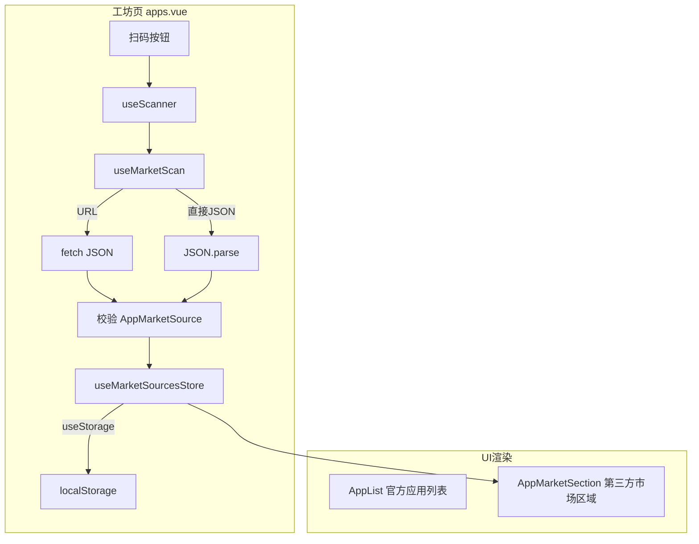

## 用户需求

1. 移除工坊页（apps.vue）和发现页（discovery.vue）中 CloudBase 查询失败时显示的黄色错误横幅提示
2. 在工坊页右上角添加扫码按钮，用于扫描添加第三方应用市场
3. 扫码后解析二维码数据，支持 URL（fetch 返回 JSON）和直接 JSON 两种格式
4. 抽取公共的应用市场列表格式（AppMarketSource），官方与第三方市场格式统一
5. 第三方市场的应用以独立分组/区域展示（类似 iOS TestFlight 风格）
6. 第三方市场数据通过 localStorage 持久化

## 产品概述

为云乐坊工坊页增加第三方应用市场支持能力。用户通过工坊页右上角的扫码按钮扫描二维码，解析获取第三方市场的元数据（名称、图标、描述）和应用列表，添加到本地。工坊页在官方应用列表下方，按市场来源分组展示第三方应用，每个市场作为独立的可折叠区域，标注来源信息。同时移除两个页面的错误横幅提示，查询失败时静默降级到静态数据即可。

## 核心功能

- 移除 apps.vue 和 discovery.vue 的黄色错误警告横幅
- 工坊页右上角新增扫码按钮，复用已有 useScanner 基础设施
- 定义统一的 AppMarketSource 类型，包含市场元数据和符合 YlfAppInfo 格式的应用列表
- 扫码结果解析逻辑：识别 URL 则 fetch 获取 JSON，否则直接解析 JSON
- 新建 Pinia store 管理第三方市场列表，通过 useStorage 持久化到 localStorage
- 工坊页新增第三方市场分组区域组件，每个市场独立展示，支持删除市场

## 技术栈

- 框架：Nuxt 4（CSR 模式）+ Vue 3 Composition API
- UI：Ionic Vue + Konsta UI（复用项目现有 UI 体系）
- 状态管理：Pinia + `@vueuse/core` 的 `useStorage` 持久化
- 扫码：复用已有 `useScanner` / `ScannerBarcode` 基础设施
- 样式：Tailwind CSS + UnoCSS Icons

## 实现方案

### 整体策略

1. **统一市场格式**：定义 `AppMarketSource` 接口作为市场数据的标准格式，包含市场元数据（id、name、icon、url）和应用列表（`YlfAppInfo[]`）。官方数据（ALL_APPS）也可以被视为一个特殊的 AppMarketSource。
2. **扫码添加市场**：在工坊页右上角新增扫码按钮，复用已有 `useScanner` composable。扫码结果通过新建的 `useMarketScan` composable 处理——先尝试解析为 URL 并 fetch JSON，失败则尝试直接 JSON.parse。
3. **持久化存储**：新建 `useMarketSourcesStore` Pinia store，使用 `useStorage` 将第三方市场列表持久化到 localStorage（key: `ylf:market-sources`）。
4. **UI 展示**：在工坊页 `<AppList />` 下方新增 `<AppMarketSection />` 组件，遍历第三方市场列表，每个市场渲染为一个独立的 iOS 风格分组卡片（标题栏 + 应用子列表 + 删除按钮）。

### 关键技术决策

- **复用 useScanner 而非重新实现**：项目已有完善的 Native/Web 双端扫码方案（`useScanner` + `ScannerBarcode`），直接复用。
- **URL 优先，JSON 兜底**：扫码结果先检查是否为 HTTP URL，是则 fetch 获取 JSON；否则尝试 `JSON.parse` 直接解析。两者都失败则提示用户格式无效。
- **市场 ID 通过 URL 或 name 生成**：使用 `Date.now()` + name 拼接作为唯一 ID，防止重复添加同源市场时通过 URL 去重。
- **不修改现有 useWorkshop / useDiscovery 的 error 逻辑**：error 状态保留在 composable 中用于内部判断，只在页面层移除 UI 展示。

## 实现注意事项

- **扫码结果验证**：需要严格校验 JSON 结构是否符合 AppMarketSource 格式，避免恶意数据。至少要校验 `name` 字段存在且 `apps` 为数组。
- **fetch 超时控制**：URL 模式使用 AbortController 设置 10s 超时，避免扫码后长时间无响应。
- **去重检测**：添加市场时检查 URL 是否已存在（URL 模式）或 name 是否重复，提示用户。
- **不破坏现有逻辑**：error 横幅仅在模板层移除，composable 中的 error 状态和 catch fallback 逻辑保持不变。

## 架构设计



## 目录结构

```
app/
├── types/
│   └── market.ts                    # [NEW] AppMarketSource 接口定义，统一市场格式
├── stores/
│   └── marketSources.ts             # [NEW] Pinia store，管理第三方市场列表，useStorage 持久化
├── composables/
│   └── useMarketScan.ts             # [NEW] 扫码结果解析 composable，URL fetch / JSON parse + 格式校验
├── components/
│   └── app/
│       └── MarketSection.vue        # [NEW] 第三方市场分组展示组件，遍历市场列表，每个市场独立卡片展示
├── pages/
│   └── tabs/
│       ├── apps.vue                 # [MODIFY] 移除错误横幅，添加扫码按钮 + ScannerBarcode 组件 + MarketSection
│       └── discovery.vue            # [MODIFY] 移除错误横幅
├── composables/
│   ├── useWorkshop.ts               # [MODIFY] 移除 error 从返回值的解构需求（可选，页面不再使用）
│   └── useDiscovery.ts              # 无需修改（error 保留在内部，页面不展示即可）
```

### 文件详细说明

- **`app/types/market.ts`** [NEW]：定义 `AppMarketSource` 接口（id, name, icon, description, url, apps: YlfAppInfo[], addedAt）。这是第三方市场数据的标准格式，二维码中的 JSON 数据需要符合此格式。同时导出 `validateMarketSource()` 校验函数。

- **`app/stores/marketSources.ts`** [NEW]：Pinia store，使用 `useStorage<AppMarketSource[]>('ylf:market-sources', [])` 管理市场列表。提供 `addSource(source)` / `removeSource(id)` / `hasSource(url)` 方法。跟随已有 `app/stores/app.ts` 的模式（setup store + HMR）。

- **`app/composables/useMarketScan.ts`** [NEW]：封装扫码结果到市场数据的完整流程。`parseMarketData(content: string): Promise<AppMarketSource>` 方法：先判断是否为 URL（startsWith http），是则 fetch + JSON parse；否则直接 JSON.parse。返回前调用 validateMarketSource 校验。

- **`app/components/app/MarketSection.vue`** [NEW]：展示所有第三方市场。每个市场渲染为一个 iOS 风格的分组卡片：标题栏（市场名 + 图标 + 应用数量 + 删除按钮），下方为该市场的应用列表（复用与 AppList 类似的应用行样式）。无第三方市场时不渲染。

- **`app/pages/tabs/apps.vue`** [MODIFY]：(1) 移除 `v-if="error"` 的黄色横幅 div。(2) 从 useWorkshop 解构中移除 error。(3) 在 IonToolbar 的 IonButtons slot="end" 中添加扫码按钮（使用 `qrCodeOutline` 图标）。(4) 引入 useScanner + useMarketScan + ScannerBarcode 组件。(5) 在 `<AppList />` 下方添加 `<AppMarketSection />`。

- **`app/pages/tabs/discovery.vue`** [MODIFY]：移除 `v-if="error"` 的黄色横幅 div，从 useDiscovery 解构中移除 error。

## 关键类型定义

```typescript
// app/types/market.ts
import type { YlfAppInfo } from '~~/packages/types'

/** 应用市场来源 */
export interface AppMarketSource {
  /** 唯一标识 */
  id: string
  /** 市场名称 */
  name: string
  /** 市场图标（emoji 或 URL） */
  icon?: string
  /** 市场描述 */
  description?: string
  /** 数据源 URL（用于去重和刷新） */
  url?: string
  /** 应用列表 */
  apps: YlfAppInfo[]
  /** 添加时间戳 */
  addedAt: number
}
```

## Agent Extensions

### Skill

- **vue-best-practices**
- 用途：确保新建的 Vue 组件（MarketSection.vue）和 composable（useMarketScan.ts）遵循 Vue 3 Composition API 最佳实践
- 预期结果：组件使用 `<script setup>` + TypeScript，composable 遵循命名和返回值约定

- **pinia**
- 用途：新建 marketSources store 时遵循 Pinia 最佳实践，与现有 app.ts store 保持一致的 setup store 模式
- 预期结果：store 使用 defineStore + setup 语法 + HMR 支持

- **vueuse-functions**
- 用途：在 store 中使用 `useStorage` 实现 localStorage 持久化，与现有 app.ts store 保持一致
- 预期结果：市场数据自动响应式持久化到 localStorage