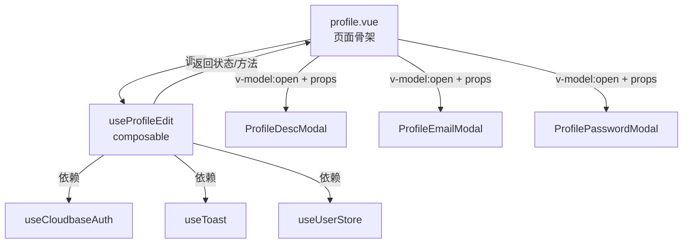

## 用户需求

对 `app/pages/user/profile.vue`（694行单体文件）进行架构优化重构，同时修复 Sheet Modal 中输入框被键盘遮挡的问题。

## 产品概述

将个人资料页面从单体 694 行文件拆分为多个功能解耦的模块，遵循项目现有的 composable 分层模式和组件组织规范。同时解决所有包含表单输入的 Sheet Modal（编辑简介、换绑邮箱、重设密码）在键盘弹出时内容被遮挡无法操作的问题。

## 核心功能

1. **Composable 拆分**：将 profile.vue 中的用户资料展示逻辑、编辑操作逻辑、第三方账号绑定逻辑抽取为独立的 composable，通过清晰的接口通信
2. **组件拆分**：将 3 个内联 Sheet Modal（编辑简介、换绑邮箱、重设密码）抽取为独立组件，放入 `app/components/user/` 目录
3. **键盘遮挡修复**：修复 Sheet Modal 中输入框聚焦时键盘弹出但 Modal 不上移、内容被遮挡的问题，确保用户在所有 Modal 表单场景中能正常输入

## 技术栈

- 框架：Nuxt 4 (CSR) + Ionic Vue + Konsta UI
- 语言：TypeScript + Vue 3 Composition API (`<script setup>`)
- 样式：Tailwind CSS 4 + SCSS
- 移动端：Capacitor 7（含 `@capacitor/keyboard` 7.0.3 已安装）

## 实现方案

### 整体策略

遵循项目现有的 composable 分层组合模式（参考 `useCloudbaseAuth` = Core + Otp + OAuth 组合、`useAppForm` 大型 composable 的组织方式），将 profile.vue 拆分为：

1. **一个聚合 composable `useProfileEdit`**：统一导出用户资料编辑的所有状态和方法
2. **三个独立 Modal 组件**：将 3 个内联 IonModal 抽取为 `app/components/user/` 下的 SFC 组件
3. **键盘适配方案**：将包含输入框的 Sheet Modal 改为全屏 presentingElement Modal，利用 IonContent 原生滚动能力适配键盘

### 关键技术决策

**1. Composable 拆分粒度**

profile.vue 的 script 逻辑虽然有 296 行，但内聚性较强——都围绕"用户资料编辑"这一主题。参考项目中 `useAppForm`（333行）将表单逻辑统一管理的模式，将所有编辑逻辑抽取为一个 `useProfileEdit` composable，而非拆为多个过细的 composable。原因：

- 各编辑功能共享 `useCloudbaseAuth()` 返回的 `user`、`loading`、`updateUserInfo` 等状态和方法
- 共享 `useToast()` 和 `useUserStore()` 依赖
- 拆太细反而增加 composable 间的传参和协调成本

**2. 键盘遮挡问题根因与修复方案**

根因分析：

- `capacitor.config.ts` 中 Keyboard 插件配置了 `resize: 'none'`，即键盘弹出不会调整 WebView 大小
- Sheet Modal 使用固定 breakpoint（如 `[0, 0.45, 0.75]`），键盘弹出时 Modal 高度不变，输入框被键盘遮挡
- 项目已安装 `@capacitor/keyboard` 7.0.3 但未在代码中使用其事件监听

修复方案——**将含表单的 Sheet Modal 改为 fullscreen Modal**：

- 对 3 个包含输入的 Modal（编辑简介、换绑邮箱、重设密码），移除 breakpoint/initialBreakpoint 配置，改为全屏卡片式 Modal（`presentingElement` 模式）
- 全屏 Modal 内的 `IonContent` 拥有完整的滚动能力，Ionic 框架会自动处理键盘弹出时的 scroll-into-view
- 此方案无需引入额外的键盘事件监听代码，利用 Ionic 原生机制解决问题
- 不修改全局 `resize: 'none'` 配置，避免影响其他页面布局

为什么不选择动态调整 breakpoint 方案：

- 需要监听键盘事件计算精确高度，代码复杂且易出 bug
- 不同设备键盘高度不一，兼容性差
- Sheet Modal 高度计算与键盘高度的协调逻辑脆弱

**3. 组件抽取策略**

将 3 个 Modal 抽取为独立 SFC 组件。每个组件通过 `v-model:open` 控制显隐，内部管理自己的表单状态和提交逻辑，通过 props/emits 与父组件通信。这样 profile.vue 的模板从约 400 行减少到约 200 行。

## 实现注意事项

- **保持自动导入**：新增的 composable 放在 `app/composables/` 下，新增组件放在 `app/components/user/` 下，Nuxt 自动导入，无需手动 import
- **保持样式复用**：继续使用 `override.scss` 中已定义的 `ios-icon-box`、`ios-secondary-text`、`ios-avatar-bg`、`k-list-item-destructive` 等全局样式类
- **不修改 useCloudbaseAuth 接口**：重构只在消费端（profile.vue）层面进行，不触碰底层 auth composable
- **presentingElement 获取**：全屏 Modal 需要传入 `presenting-element` prop（通常为 IonPage 的 DOM 引用），使用 `ref<HTMLElement>` 获取 `IonPage` 引用

## 架构设计

### 重构前后对比

重构前：

- `profile.vue`（694行）= 296行 script + 398行 template，包含所有逻辑和 3 个内联 Modal

重构后：

- `profile.vue`（约 220 行）= 精简的页面骨架 + 组件组合
- `useProfileEdit.ts`（约 200 行）= 所有用户资料编辑逻辑
- `ProfileDescModal.vue`（约 60 行）= 编辑简介 Modal
- `ProfileEmailModal.vue`（约 100 行）= 换绑邮箱 Modal
- `ProfilePasswordModal.vue`（约 90 行）= 重设密码 Modal

### 模块通信接口



### 数据流

1. `useProfileEdit` 调用 `useCloudbaseAuth()` 获取 `user`、`loading`、`updateUserInfo` 等
2. 计算属性（displayName、displayPhone 等）在 composable 中定义，返回给 profile.vue 使用
3. 编辑操作方法（editNickname、editGender 等）在 composable 中定义并返回
4. Modal 组件通过 `v-model:open` 双向绑定显隐状态，通过 props 接收必要数据（如 user、authLoading），通过 emits 触发操作完成事件

## 目录结构

```
app/
├── composables/
│   └── useProfileEdit.ts          # [NEW] 用户资料编辑聚合 composable。负责：15个计算属性（displayName/displayPhone/isGitHubBound 等）、编辑昵称（alertController 弹窗）、编辑性别（actionSheetController）、手机号提示、绑定/解绑微信和 GitHub、复制剪贴板、刷新信息。依赖 useCloudbaseAuth + useToast + useUserStore。
├── components/
│   └── user/                      # [NEW] 用户资料相关组件目录
│       ├── ProfileDescModal.vue   # [NEW] 编辑简介全屏 Modal 组件。Props: open(boolean), user(CloudbaseUser), authLoading(boolean), presentingElement(HTMLElement)。Emits: update:open, saved。内部管理 descEditValue 表单状态，调用 updateUserInfo 保存。
│       ├── ProfileEmailModal.vue  # [NEW] 换绑邮箱全屏 Modal 组件。Props: open(boolean), user(CloudbaseUser), authLoading(boolean), presentingElement(HTMLElement)。Emits: update:open, saved。内部管理两步表单状态机（input->verify），调用 changeEmail + verifyEmailBindOtp。
│       └── ProfilePasswordModal.vue # [NEW] 重设密码全屏 Modal 组件。Props: open(boolean), authLoading(boolean), presentingElement(HTMLElement)。Emits: update:open, saved。内部管理 oldPassword/newPassword/confirmPassword 表单验证，调用 resetPasswordWithOld。
└── pages/
    └── user/
        └── profile.vue            # [MODIFY] 精简为页面骨架。移除所有内联逻辑和 Modal 模板，改为调用 useProfileEdit composable + 引用 3 个 Modal 子组件。获取 IonPage ref 作为 presentingElement 传递给 Modal。
```

## 关键代码结构

```typescript
// useProfileEdit.ts - 返回接口
interface ProfileEditReturn {
  // 状态
  user: Readonly<Ref<CloudbaseUser | null>>
  authLoading: Readonly<Ref<boolean>>
  // 计算属性
  displayName: ComputedRef<string>
  displayDescription: ComputedRef<string>
  displayPhone: ComputedRef<string>
  displayEmail: ComputedRef<string>
  displayGender: ComputedRef<string>
  joinDate: ComputedRef<string>
  avatarInitial: ComputedRef<string>
  isGitHubBound: ComputedRef<boolean>
  isWeChatBound: ComputedRef<boolean>
  isPhoneBound: ComputedRef<boolean>
  isEmailBound: ComputedRef<boolean>
  hasPassword: ComputedRef<boolean>
  // 操作方法
  fetchUser: () => Promise<void>
  editNickname: () => Promise<void>
  editGender: () => Promise<void>
  handlePhoneTap: () => void
  handleWeChatTap: () => Promise<void>
  handleGitHubTap: () => Promise<void>
  copyToClipboard: (text: string) => Promise<void>
  handleRefresh: () => Promise<void>
  // Modal 需要的 auth 方法（透传给子组件）
  updateUserInfo: (params: any) => Promise<boolean>
  changeEmail: (email: string) => Promise<any>
  verifyEmailBindOtp: (...args: any[]) => Promise<boolean>
  resetPasswordWithOld: (old: string, new_: string) => Promise<boolean>
}
```

## Agent Extensions

### Skill

- **vue-best-practices**
- 用途：确保 Vue 3 Composition API + `<script setup>` 重构遵循最佳实践，composable 设计符合 Vue 3 规范
- 预期结果：composable 返回值类型安全，ref/reactive 使用正确，组件 props/emits 定义规范

- **nuxt**
- 用途：确保新增的 composable 和组件遵循 Nuxt 4 自动导入规则和文件组织规范
- 预期结果：新增文件放在正确路径下，无需手动 import 即可使用

### SubAgent

- **code-explorer**
- 用途：在实现每个拆分步骤前，确认相关依赖文件的准确接口和类型定义
- 预期结果：确保重构代码与现有 API 接口完全兼容，无遗漏