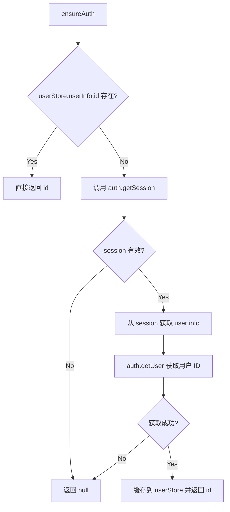

## 用户需求

用户在"我的应用"页面点击进入应用详情时，频繁遇到"应用不存在或无权访问"的错误。上一轮的修复（调整 ensureAuth 优先级）没有真正解决问题。用户要求重新设计整个应用管理的增删改查交互。

## 产品概述

重新设计"我的应用"模块的完整 CRUD 交互流程，彻底修复认证问题导致数据查询失败的根因，确保列表浏览、创建、查看详情、编辑、删除、访问应用等所有操作流程稳定可靠。

## 核心功能

1. **认证层重构**：彻底解决 `useCloudbaseAuthCore` 每次调用创建新 `user` ref 导致 `ensureAuth()` 认证恢复不稳定的问题。改为直接依赖 CloudBase SDK 内部已有的认证态（`auth.getSession()`），不再依赖非单例的 composable user ref
2. **我的应用列表**：稳定加载当前用户的所有应用，支持下拉刷新，列表项点击进入详情不再报错
3. **应用详情页**：可靠加载应用数据，提供"打开应用"、编辑、删除等操作入口，加载失败时提供重试机制而非直接跳走
4. **创建应用**：表单创建流程保持不变，修复 `handleSubmit` 中依赖非单例 `user.value` 的问题
5. **编辑应用**：可靠加载已有数据并填充表单，保存修改后刷新详情
6. **删除应用**：二次确认后删除，返回列表并刷新

## 技术栈

- 框架：Nuxt 4 (CSR) + Vue 3 Composition API
- UI：Ionic Vue + Konsta UI
- 数据：CloudBase JS SDK NoSQL 数据库
- 认证：CloudBase Auth（`@cloudbase/js-sdk`）
- 状态：Pinia（userStore）

## 实现方案

### 核心问题分析

当前 `useApps.ts` 的 `ensureAuth()` 方法存在链式不可靠的认证恢复逻辑：

1. `useCloudbaseAuth()` -> `useCloudbaseAuthCore()` 每次调用创建**全新的** `user` ref（初始为 null），不是全局单例
2. `ensureAuth()` 检查 `user.value` 永远为 null，然后 fallback 到 `userStore.userInfo?.id`，但 `YlfUserInfo.id` 是 optional，且 `isLoggedIn` 仅检查 `accessToken + nickname`，不保证 `id` 存在
3. 如果前两步都失败，调用 `auth.getSession()` + `checkAuthStatus()` 恢复，但 `checkAuthStatus` 更新的是当前实例的 user ref，恢复链路过长且容易在任一环节失败

### 解决策略

**彻底重写 `ensureAuth()`**：不再依赖非单例的 `useCloudbaseAuth()` user ref，改为直接使用 CloudBase SDK 的 `auth.getSession()` 获取用户 ID。CloudBase SDK 的 auth 实例是通过 `useNuxtApp()` 缓存的全局单例，其内部维护了 `persistence: 'local'` 的登录态，`getSession()` 会返回当前用户的完整 session（包含 access_token 和用户身份）。

具体改动：

- `ensureAuth()` 直接调用 `auth.getSession()` 获取 session，从 session 中提取用户 ID（通过解析 JWT 或调用 `auth.getUser()`），不再经过 `useCloudbaseAuth()` 的非单例 user ref
- 移除 `useApps` 对 `useCloudbaseAuth` 的依赖，仅依赖 `useCloudbase()` 返回的 `auth` 实例
- `userStore.userInfo.id` 作为快速路径缓存，但 session 恢复不再依赖它

**同步修复 `useAppForm.ts`**：`handleSubmit` 中的 `user.value` 检查也有同样问题，改为使用 `userStore.isLoggedIn` 判断。

**改善详情页和编辑页的错误处理**：加载失败时不再立即跳走，而是显示错误状态并提供重试按钮，与编辑页的 `error-state` 模式统一。

## 实现细节

### 1. `useApps.ts` 重写 ensureAuth



关键改动点：

- 移除 `const { user, checkAuthStatus } = useCloudbaseAuth()` 依赖
- `ensureAuth` 改为：先查 userStore 缓存 -> 调 `auth.getSession()` 确保 SDK 登录态 -> 如需要则调 `auth.getUser()` 获取用户 ID 并同步到 store
- `createApp` 中的 `ownerLogin` 也从 userStore 获取，不再依赖 `user.value`

### 2. `useAppForm.ts` 修复登录检查

- `handleSubmit` 中 `if (!user.value)` 改为 `if (!userStore.isLoggedIn)`，通过 Pinia store 判断登录态

### 3. 详情页 `[slug]/index.vue` 改善交互

- 加载失败时不再 `router.replace('/apps/my')` 强制跳走
- 改为显示错误状态页（带重试按钮和返回按钮），与编辑页保持一致
- 使用 `onIonViewWillEnter` 生命周期在页面重新进入时刷新数据

### 4. 编辑页成功后返回详情

- 编辑保存成功后如果 slug 未变，返回详情页而非列表页

## 架构设计

```mermaid
graph TB
    subgraph Pages
        MY["/apps/my<br>我的应用列表"]
        NEW["/apps/new<br>创建应用"]
        DETAIL["/apps/:slug<br>应用详情"]
        EDIT["/apps/:slug/edit<br>编辑应用"]
    end

    subgraph Composables
        UA["useApps()<br>数据 CRUD"]
        UAF["useAppForm()<br>表单逻辑"]
    end

    subgraph Auth
        UCB["useCloudbase()<br>SDK 单例"]
        US["userStore<br>Pinia 状态"]
    end

    MY --> UA
    NEW --> UAF --> UA
    DETAIL --> UA
    EDIT --> UAF

    UA --> UCB
    UA --> US
    UAF --> US
end
```

改动前 `useApps` 同时依赖 `useCloudbase` + `useCloudbaseAuth`（非单例），改动后仅依赖 `useCloudbase`（单例）+ `userStore`（全局单例）。

## 目录结构

```
app/
├── composables/
│   ├── useApps.ts           # [MODIFY] 重写 ensureAuth，移除对 useCloudbaseAuth 的依赖，改为直接使用 CloudBase auth 实例 + userStore
│   └── useAppForm.ts        # [MODIFY] 修复 handleSubmit 中的登录态检查，改用 userStore.isLoggedIn
├── pages/apps/
│   ├── my.vue               # [MODIFY] 轻微改进：onIonViewWillEnter 确保返回时刷新列表
│   ├── new.vue              # 无需改动（依赖 useAppForm 修复即可）
│   └── [slug]/
│       ├── index.vue        # [MODIFY] 改善错误处理：不再强制跳走，显示错误状态+重试按钮
│       └── edit.vue         # [MODIFY] 保存成功后返回详情页而非列表页
└── types/
    └── app.ts               # 无需改动
```