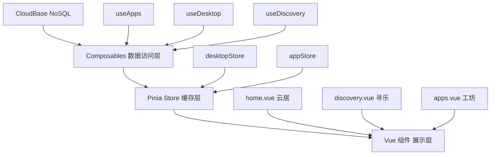
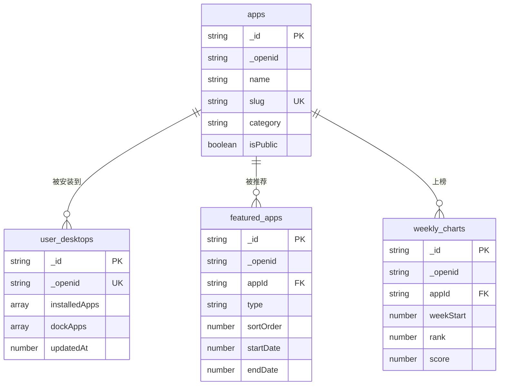

## 产品概述

完善云乐坊应用的三个核心 Tab 页面（云居、寻乐、工坊）功能设计，将当前硬编码数据驱动的静态页面升级为基于 CloudBase 数据库的动态功能完整的应用平台。

## 核心功能

### 云居（Home）- 用户桌面

- **最近使用区域**：展示最近使用的云应用，每行四个，默认展示最近四个，点击右侧「更多」查看历史，上限 100 个；无数据时隐藏该区域
- **主体桌面**：类 iOS 桌面体验，展示用户已安装的云应用；支持长按弹出菜单/移除应用、拖拽移动位置排序、翻页（左右滑动分页，每页 4x6=24 个）、拖拽时轻震动反馈
- **底部常用栏（Dock）**：固定四个常用应用，不显示名称，不与主体桌面重叠，支持拖拽编辑
- **数据同步**：用户已安装应用、桌面排序、Dock 配置通过 CloudBase 存储，实现跨设备同步

### 寻乐（Discovery）- 发现推荐

- **每日精选推荐**：展示编辑精选的推荐应用，参考 iOS App Store 的大卡片设计
- **当周热门排行**：展示本周热门应用列表
- **数据来源**：从 CloudBase 数据库读取推荐数据和热门榜单，支持后台运营管理

### 工坊（Apps）- 应用商店

- **分类浏览**：展示不同分类的应用，支持分类标签切换筛选
- **搜索功能**：支持按名称、描述等关键词搜索应用
- **应用获取**：用户点击「获取」后将应用安装到云居桌面
- **数据来源**：从 CloudBase 数据库实时检索应用数据

### 数据架构

- 设计新的 CloudBase NoSQL 集合（user_desktops、featured_apps、weekly_charts）
- 数据结构文档以 Markdown 格式存档于 docs/database 目录
- 基础功能架构设计文档更新至 docs/design 目录

## 技术栈

- **前端框架**：Nuxt 4（SPA） + Ionic Vue + Konsta UI（沿用现有）
- **样式**：Tailwind CSS 4 + UnoCSS presetIcons（沿用现有）
- **状态管理**：Pinia（沿用现有）
- **后端数据**：CloudBase NoSQL（@cloudbase/js-sdk）
- **移动端交互**：@capacitor/haptics（触觉反馈）
- **拖拽排序**：vuedraggable-es（基于 SortableJS 的 Vue 3 封装）
- **翻页交互**：CSS scroll-snap + touch 事件自定义实现（无额外依赖，轻量高性能）

## 实现方案

### 整体策略

将三个 Tab 页面从硬编码静态数据驱动，升级为 CloudBase NoSQL 动态数据驱动。新增三个数据集合（user_desktops、featured_apps、weekly_charts），扩展现有 `apps` 集合的查询能力。前端通过新增 composable 封装数据访问层，页面组件消费响应式数据。

### 关键技术决策

1. **桌面数据存储**：新建 `user_desktops` 集合，每用户一条文档，存储已安装应用 ID 列表、排序信息和 Dock 配置。选择单文档而非多文档方案，因为桌面本质是用户的个性化配置，读写粒度天然为整体，单文档设计减少查询次数，降低安全规则复杂度。

2. **应用引用方式**：桌面存储应用的 `_id`（CloudBase 数据）或 `code`（静态应用），通过统一的 resolver 在展示时解析完整应用信息。这样桌面数据轻量，且应用信息更新后桌面自动获取最新版本。

3. **拖拽实现**：采用 `vuedraggable-es`（SortableJS Vue 3 封装），原因：成熟稳定，支持触摸设备，支持跨列表拖拽（主桌面与 Dock 间），支持动画。配合 Capacitor Haptics 实现拖拽时的轻震动。

4. **翻页实现**：使用 CSS `scroll-snap-type: x mandatory` + `scroll-snap-align: start` 实现原生级翻页体验，辅以页面指示器（dots）。每页 24 个应用（4列 x 6行），通过 computed 自动分页。

5. **工坊数据查询**：扩展 `apps` 集合安全规则，新增按分类和搜索查询公开应用的能力。搜索采用 CloudBase 正则匹配（`db.RegExp`），分页加载。

6. **推荐数据管理**：`featured_apps` 存储编辑精选推荐（含周期、排序），`weekly_charts` 存储周榜数据。安全规则设为所有登录用户可读，仅管理员可写（通过 `_openid` 限制写入者）。

### 性能考量

- 桌面数据采用 Pinia store 缓存 + CloudBase 异步同步策略：先从 localStorage 读取缓存快速渲染，后台与 CloudBase 同步
- 工坊列表采用分页加载（每次 20 条），配合 Ionic 的 `ion-infinite-scroll` 实现无限滚动
- 拖拽排序变更采用防抖写入（500ms），避免频繁数据库操作

## 实现注意事项

- CloudBase 安全规则约束：`user_desktops` 集合的 where 查询必须包含 `_openid` 字段；`apps` 集合公开数据查询必须包含 `isPublic: true`
- 拖拽操作需确保在编辑模式下才触发 Haptics，避免正常滑动误触
- 寻乐页推荐数据需要 fallback 机制：CloudBase 无数据时回退到静态 `FEATURED_APP` 和 `ALL_APPS` 常量
- 工坊搜索需防抖（300ms），避免输入过程中频繁查询
- 桌面同步使用乐观更新：先更新本地 store，异步写入 CloudBase，失败时 toast 提示

## 架构设计

### 数据流架构



### 新增集合关系



## 目录结构

```
project-root/
├── docs/
│   ├── database/
│   │   ├── apps.md                    # [MODIFY] 更新 apps 集合文档，补充公开查询模式和搜索查询说明
│   │   ├── user-desktops.md           # [NEW] 用户桌面集合文档。定义 user_desktops 集合结构（installedApps 排序数组、dockApps 数组、页面布局）、索引、安全规则、查询模式
│   │   ├── featured-apps.md           # [NEW] 精选推荐集合文档。定义 featured_apps 集合结构（appId/type/sortOrder/startDate/endDate）、安全规则、运营查询模式
│   │   └── weekly-charts.md           # [NEW] 周榜集合文档。定义 weekly_charts 集合结构（appId/weekStart/rank/score）、安全规则
│   └── design/
│       └── tabs-architecture.md       # [NEW] 三个 Tab 页架构设计文档。描述云居/寻乐/工坊的功能架构、数据流、组件关系、交互规范
├── app/
│   ├── types/
│   │   ├── app.ts                     # [MODIFY] 新增 DesktopConfig/FeaturedApp/WeeklyChartEntry 等类型定义
│   │   └── desktop.ts                 # [NEW] 桌面相关类型定义。InstalledApp（appId/appSource/sortOrder）、DesktopConfig（installedApps/dockApps）、AppSource 枚举（static/cloudbase）
│   ├── stores/
│   │   └── desktop.ts                 # [NEW] 桌面状态 Store。管理已安装应用列表、Dock 配置、编辑模式状态、翻页状态。localStorage 缓存 + CloudBase 异步同步
│   ├── composables/
│   │   ├── useDesktop.ts              # [NEW] 桌面数据管理 composable。CRUD 已安装应用、排序、Dock 管理、CloudBase 同步（user_desktops 集合）
│   │   ├── useDiscovery.ts            # [NEW] 发现页数据 composable。获取精选推荐和周榜数据（featured_apps/weekly_charts 集合），含 fallback 到静态数据
│   │   ├── useAppStore.ts             # [NEW] 工坊数据 composable。按分类查询公开应用、搜索应用、分页加载（扩展 apps 集合的公开查询）
│   │   └── useApps.ts                 # [MODIFY] 扩展查询方法：getPublicApps（分页）、searchPublicApps（正则搜索）、getAppsByCategory
│   ├── components/
│   │   └── app/
│   │       ├── DesktopGrid.vue        # [NEW] iOS 风格桌面网格。支持翻页（scroll-snap）、拖拽排序（vuedraggable-es）、编辑模式抖动动画、页码指示器
│   │       ├── DesktopDock.vue        # [NEW] 桌面底部常用栏。固定 4 个应用不显示名称，支持拖拽编辑，毛玻璃背景效果
│   │       ├── InstallButton.vue      # [NEW] 应用安装按钮组件。「获取」/「已安装」状态切换，安装时将应用添加到桌面
│   │       ├── Featured.vue           # [MODIFY] 改为从 CloudBase 获取数据，保留 fallback 到静态 FEATURED_APP
│   │       └── WeeklyChart.vue        # [MODIFY] 改为从 CloudBase 获取数据，保留 fallback 到静态数据
│   ├── pages/
│   │   └── tabs/
│   │       ├── home.vue               # [MODIFY] 重构：最近使用区域（限4个+更多）、DesktopGrid（翻页+拖拽）、DesktopDock（常用栏）、编辑模式切换
│   │       ├── discovery.vue          # [MODIFY] 重构：接入 useDiscovery composable，动态加载精选推荐和周榜数据
│   │       └── apps.vue               # [MODIFY] 重构：接入 useAppStore composable，从 CloudBase 查询公开应用，搜索功能接入真实数据库，添加「获取」安装交互
│   └── constants/
│       └── apps/
│           └── index.ts               # [MODIFY] 保留静态应用数据作为 fallback 和初始种子数据
└── package.json                       # [MODIFY] 添加 vuedraggable-es 依赖
```

## 关键代码结构

```typescript
/** 桌面配置类型 - app/types/desktop.ts */
interface InstalledApp {
  /** 应用 ID（CloudBase _id 或静态应用 code） */
  appId: string
  /** 应用来源 */
  source: 'static' | 'cloudbase'
  /** 排序序号 */
  sortOrder: number
}

interface DesktopConfig {
  /** 主桌面已安装应用（有序） */
  installedApps: InstalledApp[]
  /** Dock 常用应用（最多 4 个） */
  dockApps: InstalledApp[]
  /** 最后同步时间 */
  updatedAt: number
}

/** CloudBase user_desktops 集合文档 */
interface UserDesktopRecord {
  _id: string
  _openid: string
  installedApps: InstalledApp[]
  dockApps: InstalledApp[]
  createdAt: number
  updatedAt: number
}
```

## 设计风格

采用 iOS 原生设计语言，高度还原 Apple iOS 桌面和 App Store 的视觉体验。整体风格简洁纯净，注重层次感和空间感。通过毛玻璃材质、微妙阴影、圆角和流畅动画营造高端、精致的界面氛围。暗黑模式采用纯黑背景搭配柔和光影。

## 页面设计

### 云居（Home）- 桌面页

- **顶部区域**：标准 Ionic Header + 搜索栏，简洁标题「云居」
- **最近使用区块**：区域标题「最近使用」+ 右侧「更多」文字链接；一行四个应用图标（带名称），圆角矩形图标风格与桌面一致；无数据时整块隐藏
- **主体桌面区块**：满屏网格布局，每页 4列 x 6行 = 24 个应用；长按进入编辑模式时所有图标轻微抖动（CSS animation wobble）；拖拽时被拖拽图标放大并半透明化，原位留出虚线占位；左右滑动翻页，页面切换采用 scroll-snap 平滑过渡；页码指示器（小圆点）位于桌面底部，当前页高亮
- **底部常用栏**：固定于桌面底部、页码指示器上方；毛玻璃半透明背景（backdrop-filter: blur(30px)）；四个应用图标，仅显示图标不显示名称；与主体桌面有明确分隔线
- **编辑模式**：长按图标触发，所有图标左上角出现删除按钮（iOS 风格的「-」圆形按钮）；点击空白区域或完成按钮退出编辑模式

### 寻乐（Discovery）- 发现推荐页

- **顶部区域**：大标题「寻乐」+ 右侧用户头像按钮
- **今日推荐卡片**：大尺寸渐变色卡片，高度约 320px；展示日期、推荐标签（编辑精选）、应用名称、标语、应用图标和查看按钮；卡片有圆角和阴影，按下缩放反馈
- **本周热门区块**：卡片式容器，圆角 16px，浅灰背景；列表式展示（排名序号 + 64px 应用图标 + 应用名称/描述/分类 + 获取按钮）；每项之间有细线分隔

### 工坊（Apps）- 应用商店页

- **顶部区域**：标题「工坊」+ 搜索栏（iOS 风格圆角搜索框，支持取消按钮）
- **分类标签栏**：IonSegment 横向滚动分类标签（全部/整活/应用/工具/设计/插件/实验/参与/其他）
- **应用列表**：列表式布局，每项包含：64px 圆角应用图标 + 名称/描述/评分星级/分类 + 圆角「获取」按钮；已安装的应用按钮显示为「已安装」灰色状态；无限滚动加载更多
- **搜索状态**：输入时实时筛选，显示搜索结果列表；空结果显示居中提示文案

## MCP

- **cloudbase**
- Purpose: 登录 CloudBase 环境，创建 user_desktops/featured_apps/weekly_charts 三个 NoSQL 集合并配置安全规则和索引；将现有静态应用数据导入 apps 集合作为初始种子数据
- Expected outcome: 三个新集合创建完成，安全规则配置正确，apps 集合中有可查询的公开应用数据

## Skill

- **vue-best-practices**
- Purpose: 确保所有新增 Vue 组件遵循 Composition API + script setup + TypeScript 最佳实践
- Expected outcome: 组件代码符合 Vue 3 最佳实践，类型安全，响应式设计合理

- **pinia**
- Purpose: 设计 desktopStore 时遵循 Pinia 最佳实践，包括 store 定义、持久化策略和 HMR 支持
- Expected outcome: Store 结构清晰，支持 localStorage 缓存 + CloudBase 异步同步

- **nuxt**
- Purpose: 确保新增 composables 和页面遵循 Nuxt 4 自动导入和文件约定
- Expected outcome: 所有 composables 正确自动导入，页面路由正常工作

- **vueuse-functions**
- Purpose: 复用 VueUse 的 useStorage、useDebounceFn、useSwipe 等 composable，避免重复造轮子
- Expected outcome: 桌面缓存使用 useStorage，搜索防抖使用 useDebounceFn