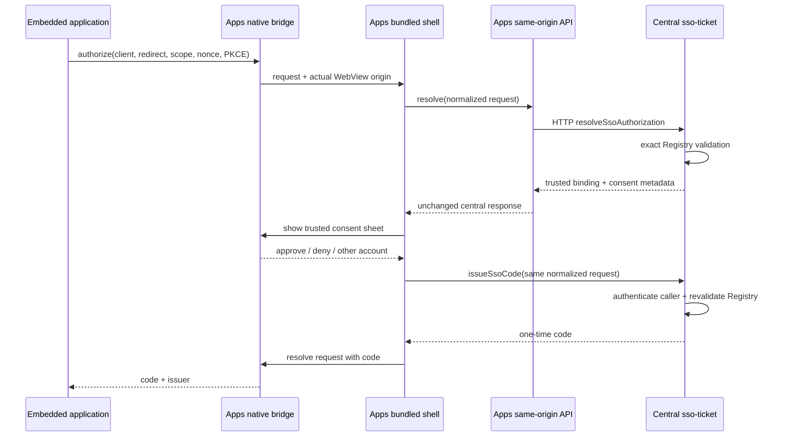

# Server-driven Host SSO Design

## Decision

Use the central `sso-ticket` function as the authorization-policy module.
Its small interface has two operations:

- `resolveSsoAuthorization(request)` validates a host request and returns a
  normalized binding plus trusted presentation metadata. Apps reaches this
  read-only, rate-limited HTTP action through its same-origin server proxy, so
  it also works before the user has a CloudBase session.
- `issueSsoCode(request)` independently revalidates that binding under the
  caller's authenticated CloudBase SDK context and issues a short-lived,
  single-use code.

The native bridge remains a transport and consent adapter; it does not own
client policy. Keeping read-only resolution on HTTP and credential issuance on
the authenticated SDK path preserves the existing least-privilege ACL.

## Security invariants

- The actual source origin is supplied by the native WebView, never by page
  display metadata or the marketplace catalog.
- `clientId`, source origin, redirect URI, scope, nonce, and S256 PKCE challenge
  are all included in both validation passes.
- Redirect URIs use exact matching; wildcard or suffix matching is forbidden.
- The Apps shell validates that the server's normalized binding exactly matches
  its pending native request before displaying or issuing.
- The issuer derives the subject only from the CloudBase caller context.
- Only a one-time code crosses into the embedded page. CloudBase and Apps tokens
  never do.
- Explicit denial is terminal. Protocol or old-host incompatibility may fall
  back to standard top-level browser SSO.

## Identity change

Native code keeps the existing fixed cookie deletion list only for legacy apps.
It broadcasts a data-free `ylf:identityChanged` event to all active hosted pages.
New identity-aware applications own their logout endpoint and clear their own
HttpOnly session after receiving that event. Therefore new applications do not
add domains or cookie names to Swift/Kotlin.

## Compatibility and rollout

1. Deploy the central resolver action first; it is additive.
2. Deploy identity-aware application changes such as Dayun session cleanup.
3. Release one Apps package using server-driven resolution and generic identity
   notification.
4. After that package reaches users, future Registry additions require only the
   normal central SSO policy release and application deployment, not a native
   package release.

Older packages remain safe: unknown host bindings fail closed, while applications
using `@yunlefun/sso` fall back to browser authorization unless the user explicitly
denied the request.

### Release gates

1. Deploy `sso-ticket` first and smoke-test HTTP resolution for one valid and
   one invalid binding. Confirm SDK issuance still rejects anonymous callers.
2. Deploy the Apps server proxy and Dayun BFF/application changes. Exercise the
   browser SSO fallback before any native release.
3. Release one Apps package, initially to an internal or staged cohort. Monitor
   resolver rejection/rate-limit events, issue success, browser fallbacks, and
   app-owned logout failures before widening rollout.
4. Add future clients only through the signed Registry release workflow. No
   marketplace field or native package edit is part of that authorization step.

### Rollback

- A resolver or proxy outage causes compatible applications to use browser SSO;
  it must never become an implicit grant.
- The Apps server proxy can be rolled back independently. A released native
  package remains safe because host authorization failures are non-authoritative
  and fall back to the external user agent.
- If the central action must be rolled back, stop onboarding new host-assisted
  clients and retain the existing issuance/exchange paths.
- Roll back Dayun SDK and BFF together because the app-bound identity-proof
  exchange is one versioned contract.

## Standards alignment

The browser fallback follows native-app guidance by using an external user agent.
Both paths use authorization code flow properties: S256 PKCE, exact redirect URI
matching, issuer binding, short-lived single-use codes, and no token transport in
URLs. The host-assisted path is a first-party extension, not a claim of generic
OAuth interoperability.

## Verification strategy

- Authorization-core tests cover trusted metadata projection and exact Registry
  policy.
- `sso-ticket` tests cover resolution, normalized binding, second-pass issuance
  validation, and rejection of altered fields.
- Apps tests cover server response binding, consent behavior, signed-out resume,
  test identities, and absence of an embedded authorization Registry.
- Native structural tests cover generic notification and legacy-only cookie
  cleanup.
- Dayun tests cover host-first login, browser fallback, explicit denial, proof
  verification, and identity-change logout.
